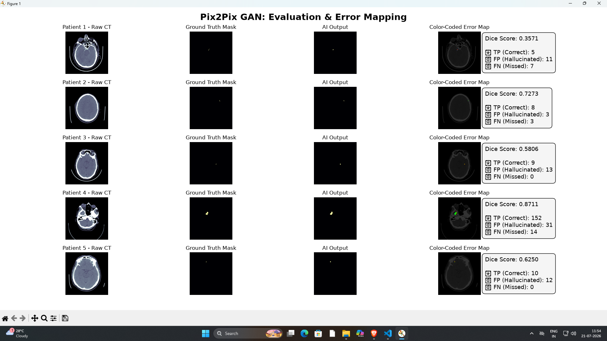

# 🧠 Automated Intracranial Hemorrhage Segmentation via Pix2Pix GAN


## 📌 Project Overview
When a patient experiences head trauma, rapid diagnosis of an Intracranial Hemorrhage (ICH) is critical. Automating this process is difficult due to extreme class imbalance—over 98% of a standard head CT scan consists of healthy tissue or background space, causing standard AI models to predict a "blank" mask to minimize loss.

This project tackles that bottleneck by framing medical segmentation as an **Image-to-Image Translation** problem. I engineered a highly customized **Pix2Pix GAN** that translates raw 2D CT scans directly into high-precision, surgical-grade diagnostic binary masks. 

---

## 🖼️ Diagnostic Evaluation Dashboard
*(The system generates a 4-column visual diagnostic map comparing the raw scan, ground truth, AI prediction, and an RGB error matrix.)*

 
> * **🟩 Green:** True Positives (Correct identification)
> * **🔴 Red:** False Positives (Conservative boundary extension)
> * **🔵 Blue:** False Negatives (Missed bleed)

---

## 🏗️ What I Built & How It Works

### 1. The Architecture (Pix2Pix GAN)
Traditional semantic segmentation models (like a standard UNet) often produce blurry boundaries because they average out pixel predictions when uncertain. To fix this, I implemented a GAN architecture:
* **The Generator (UNet):** Uses skip connections to pass early high-resolution spatial features directly to upsampling layers, preventing the positional drift of small blood lesions.
* **The Discriminator (PatchGAN):** Instead of a global scalar, this acts as a local critic. It evaluates the image in **31x31 grids (each corresponding to a 70x70 pixel receptive field)**, penalizing blurriness and forcing the Generator to output crisp, high-frequency structural edges.

### 2. Custom Radiometric Preprocessing
* **Hounsfield Windowing:** Raw CT values are clipped strictly to `[-100, 200] HU` to eliminate high-density skull artifacts and isolate soft brain tissue.
* **Normalization:** Min-Max scaled to `[0, 1]` and resized to $256 \times 256$ tensors.

### 3. Master Loss Engineering (The Secret Sauce)
To prevent the model from defaulting to empty masks, I engineered a hybrid master loss function. I introduced a custom **Weighted Binary Cross-Entropy (BCE) Loss** that applies a massive penalty multiplier whenever the AI misses a true-positive hemorrhage pixel.

The pixel weights ($w_i$) are assigned as follows:
* **30.0** if it is a true hemorrhage pixel ($y_i = 1.0$)
* **1.0** if it is background or healthy tissue ($y_i = 0.0$)

The final Master Objective Function combining Adversarial, Pixel, and Structural overlap:

$$L_G = L_{GAN} + (100 \cdot L_{Pixel}) + (100 \cdot L_{Dice})$$

---

## 📊 Final Master Evaluation Metrics

After 100 epochs of training on an NVIDIA CUDA environment, the model was frozen and evaluated across the dataset. 

| Evaluation Metric | Score | Clinical Interpretation |
| :--- | :--- | :--- |
| **Mean Dice Coefficient (F1)** | **0.7225** | Strong overall overlap with expert ground truth masks. |
| **Recall (Sensitivity)** | **0.8005** | **80% Bleed Capture:** High safety margin with minimal false negatives. |
| **Precision** | **0.6584** | Controlled over-segmentation to ensure full perimeter coverage. |
| **Pixel Efficiency (Specificity)** | **0.9998** | Near-perfect avoidance of false positives in healthy tissue. |
| **Mean IoU (Jaccard Index)** | **0.5656** | Solid intersection over union across non-contiguous lesions. |

> **Clinical Design Philosophy:** High **Recall (80.05%)** is explicitly prioritized. In emergency radiologic triage, it is vastly safer for an AI to flag a conservative boundary for a doctor to review than to miss a fatal hemorrhage pixel.

## 🚀 What's Next (Future Roadmap)

- [ ] **Web Application Integration:** Hooking up the model to a Node.js backend and building a clean, responsive frontend using React and Tailwind CSS. The goal is to let users just drag and drop a CT scan and see the segmented results instantly in the browser.
- [ ] **Bleed Volume Calculation:** Adding a simple post-processing script to count the highlighted pixels and estimate the actual volume of the hemorrhage in milliliters.
- [ ] **Full 3D Support:** Right now, the model looks at flat 2D slices. The next major step is upgrading the architecture to process full 3D brain scans all at once for better context.

---

## 🚀 Quick Start / How to Run

1. **Clone the repo:**
   ```bash
   git clone https://github.com/Yuvraj-Malik/pix2pix
   cd pix2pix
   pip install torch torchvision matplotlib numpy
   py dataset.py
   py train.py
   py evaluate_gan.py